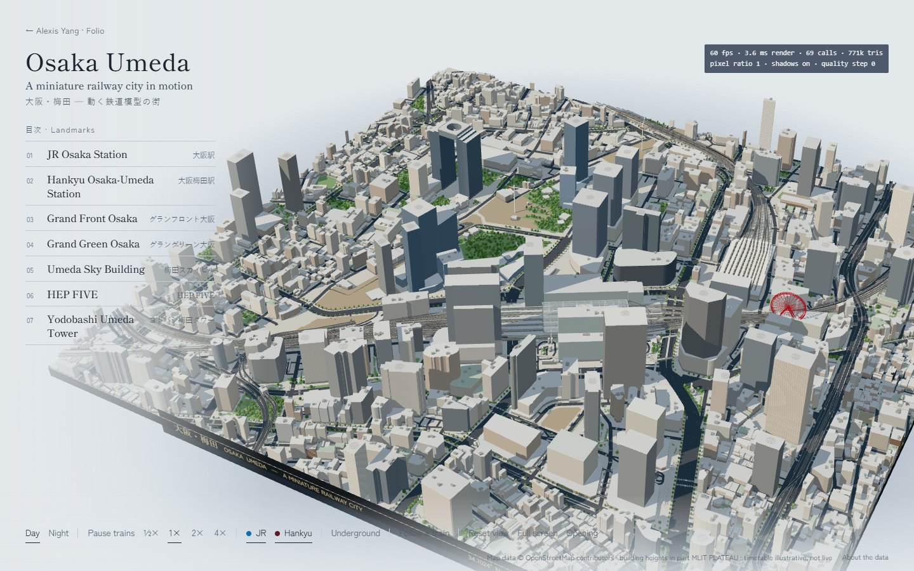

# Osaka Umeda — a miniature railway city in motion

An interactive 3D miniature of the district round JR Osaka and Hankyu Osaka-Umeda stations, built from OpenStreetMap footprints
and PLATEAU building heights, with the trains that really call there — Loop Line, Special Rapid, the Thunderbird, Super Hakuto,
Kounotori, Hamakaze, Haruka and Kuroshio, Hankyu's three lines — modelled in Blender and running an illustrative timetable at
their own platforms. A second page of this site's
build: `projects/osaka-umeda/` (→ `alexisyang.com/folio/projects/osaka-umeda/` once the folio is deployed there).



Data and licences: [DATA_SOURCES.md](DATA_SOURCES.md) · What was built and tested: [REPORT.md](REPORT.md)

## Run, test, build

```
bun install
bun run dev                                    # http://127.0.0.1:5188/projects/osaka-umeda/
bun test src/osaka                             # the timetable: routes, collisions, frame-rate independence, doors
bun run typecheck
bun run build                                  # dist/projects/osaka-umeda/ + dist/assets/
bun run preview                                # the built site, http://127.0.0.1:4173/projects/osaka-umeda/
bun scripts/harness/osaka.checks.ts http://127.0.0.1:4173    # every control, the opening, reduced motion, no-WebGL fallback
bun scripts/harness/osaka.shots.ts  http://127.0.0.1:4173    # screenshots + frame rates on this machine's GPU
bun scripts/harness/osaka.stock.ts  http://127.0.0.1:4173    # each limited express photographed on its way to its platform
```

The rolling stock is a Blender scene built by a script (Blender 5.2 LTS; no add-ons):

```
blender -b --factory-startup --python scripts/osaka/blender/rolling_stock.py -- src/osaka/assets/rolling-stock.glb [preview.png]
```

The harnesses drive the installed Chrome (`playwright-core`, channel `chrome`) with the GPU on (`--use-angle=d3d11` on Windows;
the repository's other harnesses use `metal` on a Mac).

URL options (and keys): `?nointro` skips the opening · `?landmark=hep-five` opens on a landmark · `?time=night` · `?mode=showcase` the
turning preview with no controls · `?debug` frame rate, draw calls, triangles.

## Deploy

Nothing new: the page is part of `bun run build`, and every URL in it is relative, so it works wherever `dist/` goes —
GitHub Pages (`.github/workflows/pages.yml`, on a push to `folio-test`) or the main site's `folio/` folder (FOLIO.md). The data
file is a hashed asset (`dist/assets/umeda-*.json`, 553 KB, 186 KB gzipped) and so is the rolling stock (`rolling-stock-*.glb`,
2.7 MB, 0.5 MB gzipped, loaded while the city is built); both can be cached for good.

## Put it on alexisyang.com

The main site's source is not in this repository, so these are the lines to add there.

- **The page** at `/projects/osaka-umeda/`: either link to `/folio/projects/osaka-umeda/`, or add a Cloudflare redirect —
  `/projects/osaka-umeda/*  /folio/projects/osaka-umeda/:splat  200` in `_redirects` (Pages), or the equivalent rewrite in the
  Worker.
- **A home-page preview** (the turning model, no controls; the whole preview links to the full page):

  ```html
  <iframe src="/folio/projects/osaka-umeda/?mode=showcase" title="Osaka Umeda — a miniature railway city in motion"
          loading="lazy" style="width:100%;aspect-ratio:16/9;border:0;border-radius:3px"></iframe>
  ```

  The iframe loads nothing until it scrolls near the viewport (`loading="lazy"`), and the 3D code (three.js, the engine) is a
  separate chunk the main page never downloads. The site's CSP (`frame-ancestors 'self'`) already allows a same-origin frame.
- **A nav entry**, next to Folio: EN `Osaka Umeda`, FR `Osaka Umeda`, 中文 `大阪梅田模型`, 日本語 `大阪・梅田 鉄道模型`.

## How it is built

```
scripts/osaka/      fetch_osm.py (Overpass) → raw/osm.json · build_scene.py → src/osaka/data/umeda.json · frame.py (the projection)
                    blender/rolling_stock.py → src/osaka/assets/rolling-stock.glb (every series, modelled in Blender)
src/osaka/
  data/             umeda.json (generated) · types.ts
  geo/              frame.ts (the projection, levels, gauges) · heightfield.ts (keeps the camera out of buildings)
  rail/             graph.ts (track graph, turn-limited routing) · services.ts (the timetable, resolved against the graph)
                    sim.ts (closed-form motion, block reservations) · stock.ts (dimensions) · path.ts · sim.test.ts
  scene/            city.ts (plinth, roads, buildings, trees, lamps) · track.ts (viaducts, ballast, rails, platforms, catenary)
                    landmarks.ts (JR roof, Hankyu hall, Sky Building, HEP FIVE wheel, Grand Green canopy, cranes)
                    trains.ts (loads the Blender stock; the whole fleet in one batched draw) · materials.ts · geom.ts
  view/             camera.ts (orbit, flights, follow, the opening) · lighting.ts (sun, sky environment, day/night)
  engine.ts         createOsaka(host, options) → handle: the whole miniature behind one function
  content.ts        what the page says about each landmark, and the camera views
  app/              the React page (OsakaApp.tsx, osaka.css) and its entry (main.tsx)
projects/osaka-umeda/index.html
```

It follows the repository's own patterns rather than adding new ones: an imperative three.js engine behind a `create…(host)`
handle (as `src/book/scene.ts`), React only for the words and controls, TypeScript strict, Bun tests, Vite. It adds no
dependencies — no React Three Fiber, Drei or GSAP; three.js 0.186 and its bundled addons (OrbitControls, BufferGeometryUtils) are
enough (with its GLTFLoader for the rolling stock), and the page shares the folio's three.js chunk. The rolling stock is modelled
in Blender by a script — every series lofted from its published cross-section and dimensions, its nose swept into the series'
own shape, its livery painted face by face at the heights photographs show — so a model is rebuilt, not hand-edited, and its
dimensions stay in step with `rail/stock.ts`. The landmarks stay procedural code on their OSM footprints.

### Drawing cost

The whole city is about 50–75 draw calls: every ordinary building is one merged mesh under one facade shader (floors, bays,
glass, shopfronts and night windows are computed per pixel from the wall's metres, not modelled), each landmark's buildings
one mesh, trees, crossings, piers, masts, lamps and every car of every train instanced. Frames are drawn only while something
moves; the shadow map is redrawn only when the light changes (and every few seconds for the turning wheel); a hidden tab
draws nothing. Phones start with a 1.5 pixel ratio, a 2048 shadow map and half the trees, and every device steps its pixel
ratio down (then its shadows off) if the measured frame time stays above 24 ms. Every car body and door leaf of every train is
one `BatchedMesh` — the fleet is a single draw call whatever runs.

### The railway

Who stops where follows Osaka Station's platform assignments: the Loop Line and its rapids at 1–2, westbound limited expresses
(Super Hakuto, Kounotori, Hamakaze) at 3–4, Special Rapids at 5 and 8, the Thunderbird for Tsuruga at 11, eastbound limited
expresses at 9–10, and the Haruka and Kuroshio underground at Umekita's 21–24 — the line comes up near Fukushima in an open
cutting and climbs onto its viaduct toward Nishikujō; the Underground view (U) shows its tunnel and platforms through the
street. Hankyu: Kyoto line at 1–3, Takarazuka at 4–6, Kobe at 7–9. No Shinkansen: it calls at Shin-Osaka, 3.5 km north of the
model. A test checks every stopped train stands beside its own platform face at the platform's level.

Trains are placed by their two bogie centres on the track polyline, so each car chords a curve as a real one does and the
coupler gaps hold; the head car shows white lamps, the last red, and at Hankyu's terminal the train reverses. Motion is a list
of constant-acceleration phases (cruise in, brake to the stop mark, dwell with the doors open on the platform side, accelerate
away) evaluated in closed form from simulated time, so it does not depend on the frame rate. Every service reserves each edge
and node it occupies plus a headway; services that would overlap are moved in whole seconds when the timetable is made, and
`sim.test.ts` checks a whole period at 0.25 s steps for any two trains on the same track.

## Controls

Drag to turn, right-drag (two fingers) to pan, wheel / pinch to zoom; click a building to pick a landmark. Day · Night,
Pause / Run trains, speed ½× 1× 2× 4×, JR / Hankyu trains shown, Underground (the street turns to glass over the Umekita line;
following a Haruka or Kuroshio turns it on), Follow a train (says which are on the model now), Reset view, Full screen, Opening.
Keys: N night, Space trains, U underground, R reset, F full screen, 1–7 landmarks, Esc back.
